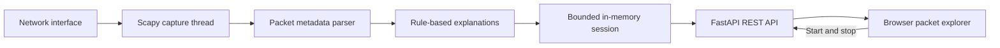

# NetLens

NetLens is a beginner-friendly, local network traffic analyzer. It captures packet metadata from an authorized network interface and presents it in a Wireshark-inspired workspace, with plain-English explanations for common events and a technical view for inspecting their fields.

NetLens is an **early prototype**. Live capture and packet inspection are implemented; PCAP imports, traffic analytics, and security insights are planned.

## What it can do

- List network interfaces and capture on an explicitly authorized interface.
- Display packet summaries during capture, filter the displayed list, and inspect a selected packet.
- Explain common events such as DNS queries and replies, TCP connection attempts, HTTP requests, and possible TLS records in plain language.
- Show available IP and MAC addresses, ports, TCP flags, packet length, and TTL or hop limit in technical mode.
- Recognize DNS, HTTP/1, TLS, TCP, UDP, ICMP, ICMPv6, ARP, IPv4, and IPv6 where the relevant information is visible in a packet.

Packet payloads, DNS names, and URLs are not stored. The current session is held in memory and is cleared when another capture starts or the process exits.

## Architecture



The browser polls the API for updates. The capture service limits its in-memory buffer to 5,000 summaries; its eviction counter does not measure packets lost by the capture driver. See [docs/architecture.md](docs/architecture.md) for the component boundaries and limitations.

## Requirements

- Python 3.10 or newer.
- [Npcap](https://npcap.com/) on Windows, or an appropriate libpcap provider on other systems.
- Permission to capture packets on the selected interface. OS permissions and driver configuration can affect capture.

## Getting started on Windows

Open PowerShell in the project folder and install the dependencies:

```powershell
python -m venv .venv
.\.venv\Scripts\python.exe -m pip install -r requirements-dev.txt
```

Install Npcap if necessary, restart PowerShell, and run the interactive launcher:

```powershell
powershell -ExecutionPolicy Bypass -File .\start-netlens.ps1
```

Choose the number for an interface you are authorized to monitor. Open [http://127.0.0.1:8000/](http://127.0.0.1:8000/), select the authorized interface, and click **Start capture**. Select a row for an explanation or switch to **Technical** for available packet fields. Click **Stop** to stop capturing. Press `Ctrl+C` in PowerShell to shut down the server.

To configure an interface manually, set the environment variable to an exact name from `GET /api/interfaces`, then start the server:

```powershell
$env:NETLENS_ALLOWED_INTERFACES = 'exact-interface-name'
.\.venv\Scripts\python.exe -m uvicorn netlens.main:app --host 127.0.0.1 --port 8000
```

The variable accepts comma-separated exact interface names. API documentation is available at [http://127.0.0.1:8000/docs](http://127.0.0.1:8000/docs).

## Why HTTP requests may not appear

Most modern websites use HTTPS: HTTP data is encrypted inside a TLS connection. NetLens cannot decrypt that traffic or see the HTTP requests inside it. Some websites also use HTTP/3 over QUIC, which this prototype does not identify. NetLens recognizes a plain HTTP/1 request or response only when its recognizable start line is visible in a single TCP packet; it does not reassemble TCP streams. A TLS label indicates a plausible record signature, not certainty about the application.

## Privacy and limitations

- Capture only on interfaces and networks you are authorized to monitor. An interface allowlist does not restrict which networks are visible on that interface.
- The application is designed for local, single-user use and has no authentication. Do not expose it publicly or on a shared network.
- Even without payloads, captured IP and MAC addresses are potentially sensitive. Do not publish real captures or logs without reviewing them.
- The browser shows up to the latest 500 buffered packets and filters those locally. It polls rather than streams over WebSockets.
- Packet descriptions are based on individual observed packets; they cannot establish the outcome or full context of a connection.
- HTTP/2, HTTP/3, QUIC, encrypted DNS, stream reassembly, and decryption are not currently supported.

## Tests

```powershell
.\.venv\Scripts\python.exe -m pytest
```

Tests use synthetic packets and a fake sniffer; they do not replace testing live capture with a local driver and an authorized interface.

## Future plans

1. Add validated PCAP and PCAPNG import using the same packet normalization pipeline.
2. Improve protocol parsing and provide richer, evidence-based explanations without retaining sensitive payloads by default.
3. Add traffic statistics, session history, and clearer capture troubleshooting.
4. Add rule-based security insights with supporting evidence and limitations.
5. Explore WebSocket updates, improved filtering, and a React-based interface as the application grows.

These are plans, not current features. Suggestions and contributions are welcome.
