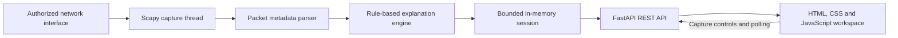

# NetLens architecture

NetLens is a local, single-user prototype. Its implemented components are shown below; planned components are described separately.

## Implemented components

- **Presentation:** The browser workspace lists captured packets, filters the latest 500 locally, and presents beginner and technical packet views. It polls the server every 1.5 seconds.
- **API:** `netlens.main` validates requests and delegates to the capture service. The application is intended to bind to localhost.
- **Capture:** `netlens.capture` owns a Scapy `AsyncSniffer` and its lifecycle. It holds a lock-protected ring of up to 5,000 packet summaries. A new capture creates a session ID and clears the prior session; stopping retains summaries until a new capture starts or the process exits. The `dropped` counter measures buffer evictions, not driver-level packet loss.
- **Normalization:** `netlens.parser` extracts available metadata, including endpoints, ports, packet length, TTL or hop limit, and TCP flags. It recognizes decoded DNS and packet-local HTTP/1 or plausible TLS record signatures. Raw payloads are not retained.
- **Explanations:** `netlens.explanations` maps the observed event to a deterministic description and limitation. DNS names and URLs are not stored, and a single packet cannot establish the outcome of an exchange.
- **Setup:** `start-netlens.ps1` lets a Windows user explicitly select an interface for that server process. `netlens.setup` provides driver and interface information to the launcher.

## Security and scope

The server is designed to listen on `127.0.0.1` and checks peer, host, and browser origin. It does not provide authentication or multi-user access controls; do not expose it on a network. Capture is limited to explicitly allowed interfaces, but an interface allowlist does not limit the networks visible on an interface. Capture only where authorized. Metadata such as IP and MAC addresses can be sensitive even without payloads.

Protocol recognition works on individual packets. It does not reconstruct TCP streams, decrypt TLS, or identify HTTP/2, HTTP/3, QUIC, or encrypted DNS. A TLS record signature is a heuristic, not proof of a particular application.

## Planned components

Offline PCAP/PCAPNG import should reuse the normalization pipeline. Other planned work includes persistent session storage, traffic analytics, evidence-backed security insights, richer protocol parsing, and WebSocket updates. A React frontend is a possible future direction; the current interface uses plain HTML, CSS, and JavaScript. These components are not yet implemented.
